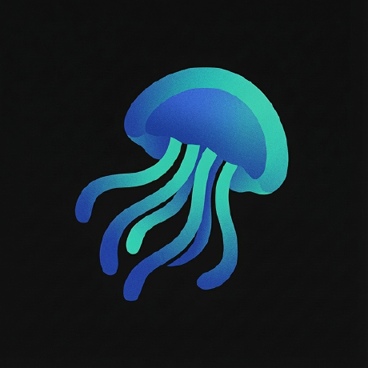
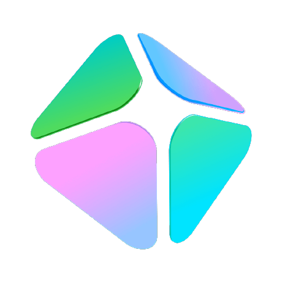
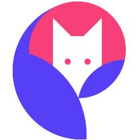
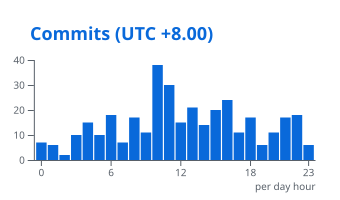
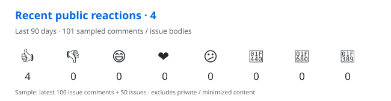

<div align="center">

# Dante / Agent Workbench

<p><samp>TypeScript · AI agents · Open source</samp></p>

<samp>
  <a href="https://dhpie.com">blog</a> ·
  <a href="https://github.com/Dante-dan?tab=repositories">code</a> ·
  <a href="https://github.com/search?q=is%3Apr+author%3ADante-dan&type=pullrequests">contributions</a> ·
  <a href="mailto:duanjl.china@gmail.com">contact</a>
</samp>

</div>

```text
$ whoami
Dante · developer · China

$ cat workflow.txt
question → investigate → build
verify → contribute → write
```

I build with TypeScript and AI agents. I investigate issues, work on fixes,
and contribute to the design discussions behind the tools I use.
I write about the process on [dhpie.com](https://dhpie.com).

[](https://ghfind.com/u/dante-dan?ref=badge)

### `~/workbench`

<sub>Recently pushed public projects · forks excluded</sub>

<!-- workbench:start -->
- **[pi-agent-book](https://github.com/Dante-dan/pi-agent-book)** — 《Pi Agent从入门到精通》：面向零基础的中文开源书，基于源码拆解上下文、记忆、工具、扩展与持续进化，附可复现实验。
- **[dayweave](https://github.com/Dante-dan/dayweave)** — Dayweave · 拾日 — An ambient personal secretary: everyday conversations to lasting text archives and thoughtful insights.
- **[dan-skills](https://github.com/Dante-dan/dan-skills)** — Public TypeScript project.
<!-- workbench:end -->

### `~/contributions`

<!-- contributions:start -->
<sub>Code accepted upstream · last 12 months</sub>

<table align="left" width="270"><tr><td width="64" valign="middle"><a href="https://github.com/LodyAI/Lody"></a></td><td width="200" valign="middle"><a href="https://github.com/LodyAI/Lody"><strong>Lody</strong></a><br /><sub><a href="https://github.com/LodyAI/Lody/pull/750">merged contribution</a><br /><a href="https://github.com/LodyAI/Lody/pulls?q=is%3Apr+author%3ADante-dan">all PRs ↗</a></sub></td></tr></table>
<table align="left" width="270"><tr><td width="64" valign="middle"><a href="https://github.com/JimLiu/baoyu-skills"></a></td><td width="200" valign="middle"><a href="https://github.com/JimLiu/baoyu-skills"><strong>baoyu-skills</strong></a><br /><sub><a href="https://github.com/JimLiu/baoyu-skills/pull/201">merged contribution</a><br /><a href="https://github.com/JimLiu/baoyu-skills/pulls?q=is%3Apr+author%3ADante-dan">all PRs ↗</a></sub></td></tr></table>
<table align="left" width="270"><tr><td width="64" valign="middle"><a href="https://github.com/CherryHQ/cherry-studio"></a></td><td width="200" valign="middle"><a href="https://github.com/CherryHQ/cherry-studio"><strong>Cherry Studio</strong></a><br /><sub><a href="https://github.com/CherryHQ/cherry-studio/pull/20487">merged contribution</a><br /><a href="https://github.com/CherryHQ/cherry-studio/pulls?q=is%3Apr+author%3ADante-dan">all PRs ↗</a></sub></td></tr></table>
<table align="left" width="270"><tr><td width="64" valign="middle"><a href="https://github.com/affaan-m/ECC"></a></td><td width="200" valign="middle"><a href="https://github.com/affaan-m/ECC"><strong>ECC</strong></a><br /><sub><a href="https://github.com/affaan-m/ECC/pull/3752">merged contribution</a><br /><a href="https://github.com/affaan-m/ECC/pulls?q=is%3Apr+author%3ADante-dan">all PRs ↗</a></sub></td></tr></table>
<table align="left" width="270"><tr><td width="64" valign="middle"><a href="https://github.com/can1357/oh-my-pi"></a></td><td width="200" valign="middle"><a href="https://github.com/can1357/oh-my-pi"><strong>oh-my-pi</strong></a><br /><sub><a href="https://github.com/can1357/oh-my-pi/pull/17061">merged contribution</a><br /><a href="https://github.com/can1357/oh-my-pi/pulls?q=is%3Apr+author%3ADante-dan">all PRs ↗</a></sub></td></tr></table>
<table align="left" width="270"><tr><td width="64" valign="middle"><a href="https://github.com/loopx-project/loopx"></a></td><td width="200" valign="middle"><a href="https://github.com/loopx-project/loopx"><strong>loopx</strong></a><br /><sub><a href="https://github.com/loopx-project/loopx/pull/7349">merged contribution</a><br /><a href="https://github.com/loopx-project/loopx/pulls?q=is%3Apr+author%3ADante-dan">all PRs ↗</a></sub></td></tr></table>
<table align="left" width="270"><tr><td width="64" valign="middle"><a href="https://github.com/heygen-com/hyperframes"></a></td><td width="200" valign="middle"><a href="https://github.com/heygen-com/hyperframes"><strong>hyperframes</strong></a><br /><sub><a href="https://github.com/heygen-com/hyperframes/pull/6395">merged contribution</a><br /><a href="https://github.com/heygen-com/hyperframes/pulls?q=is%3Apr+author%3ADante-dan">all PRs ↗</a></sub></td></tr></table>
<table align="left" width="270"><tr><td width="64" valign="middle"><a href="https://github.com/cline/cline"></a></td><td width="200" valign="middle"><a href="https://github.com/cline/cline"><strong>cline</strong></a><br /><sub><a href="https://github.com/cline/cline/pull/15296">merged contribution</a><br /><a href="https://github.com/cline/cline/pulls?q=is%3Apr+author%3ADante-dan">all PRs ↗</a></sub></td></tr></table>
<table align="left" width="270"><tr><td width="64" valign="middle"><a href="https://github.com/multica-ai/multica"></a></td><td width="200" valign="middle"><a href="https://github.com/multica-ai/multica"><strong>multica</strong></a><br /><sub><a href="https://github.com/multica-ai/multica/pull/9534">merged contribution</a><br /><a href="https://github.com/multica-ai/multica/pulls?q=is%3Apr+author%3ADante-dan">all PRs ↗</a></sub></td></tr></table>
<table align="left" width="270"><tr><td width="64" valign="middle"><a href="https://github.com/code-yeongyu/oh-my-openagent"></a></td><td width="200" valign="middle"><a href="https://github.com/code-yeongyu/oh-my-openagent"><strong>oh-my-openagent</strong></a><br /><sub><a href="https://github.com/code-yeongyu/oh-my-openagent/pull/11165">merged contribution</a><br /><a href="https://github.com/code-yeongyu/oh-my-openagent/pulls?q=is%3Apr+author%3ADante-dan">all PRs ↗</a></sub></td></tr></table>
<table align="left" width="270"><tr><td width="64" valign="middle"><a href="https://github.com/apache/maka"></a></td><td width="200" valign="middle"><a href="https://github.com/apache/maka"><strong>maka</strong></a><br /><sub><a href="https://github.com/apache/maka/pull/6151">merged contribution</a><br /><a href="https://github.com/apache/maka/pulls?q=is%3Apr+author%3ADante-dan">all PRs ↗</a></sub></td></tr></table>
<table align="left" width="270"><tr><td width="64" valign="middle"><a href="https://github.com/farion1231/cc-switch"></a></td><td width="200" valign="middle"><a href="https://github.com/farion1231/cc-switch"><strong>cc-switch</strong></a><br /><sub><a href="https://github.com/farion1231/cc-switch/pull/8254">merged contribution</a><br /><a href="https://github.com/farion1231/cc-switch/pulls?q=is%3Apr+author%3ADante-dan">all PRs ↗</a></sub></td></tr></table>
<table align="left" width="270"><tr><td width="64" valign="middle"><a href="https://github.com/makecindy/cindy"></a></td><td width="200" valign="middle"><a href="https://github.com/makecindy/cindy"><strong>Cindy</strong></a><br /><sub><a href="https://github.com/makecindy/cindy/pull/4553">merged contribution</a><br /><a href="https://github.com/makecindy/cindy/pulls?q=is%3Apr+author%3ADante-dan">all PRs ↗</a></sub></td></tr></table>
<table align="left" width="270"><tr><td width="64" valign="middle"><a href="https://github.com/anomalyco/opencode"></a></td><td width="200" valign="middle"><a href="https://github.com/anomalyco/opencode"><strong>opencode</strong></a><br /><sub><a href="https://github.com/anomalyco/opencode/pull/55778">merged contribution</a><br /><a href="https://github.com/anomalyco/opencode/pulls?q=is%3Apr+author%3ADante-dan">all PRs ↗</a></sub></td></tr></table>
<table align="left" width="270"><tr><td width="64" valign="middle"><a href="https://github.com/alibaba/open-code-review"></a></td><td width="200" valign="middle"><a href="https://github.com/alibaba/open-code-review"><strong>open-code-review</strong></a><br /><sub><a href="https://github.com/alibaba/open-code-review/pull/1610">merged contribution</a><br /><a href="https://github.com/alibaba/open-code-review/pulls?q=is%3Apr+author%3ADante-dan">all PRs ↗</a></sub></td></tr></table>
<table align="left" width="270"><tr><td width="64" valign="middle"><a href="https://github.com/LodyAI/acp-extension-dsh"></a></td><td width="200" valign="middle"><a href="https://github.com/LodyAI/acp-extension-dsh"><strong>acp-extension-dsh</strong></a><br /><sub><a href="https://github.com/LodyAI/acp-extension-dsh/pull/15">merged contribution</a><br /><a href="https://github.com/LodyAI/acp-extension-dsh/pulls?q=is%3Apr+author%3ADante-dan">all PRs ↗</a></sub></td></tr></table>
<br clear="all" />

<details>
<summary>Earlier contributions</summary>

<table align="left" width="270"><tr><td width="64" valign="middle"><a href="https://github.com/cpsoinos/nuxt-svgo"></a></td><td width="200" valign="middle"><a href="https://github.com/cpsoinos/nuxt-svgo"><strong>nuxt-svgo</strong></a><br /><sub><a href="https://github.com/cpsoinos/nuxt-svgo/pull/201">merged contribution</a><br /><a href="https://github.com/cpsoinos/nuxt-svgo/pulls?q=is%3Apr+author%3ADante-dan">all PRs ↗</a></sub></td></tr></table>
<table align="left" width="270"><tr><td width="64" valign="middle"><a href="https://github.com/GoogleChromeLabs/uach-retrofill"></a></td><td width="200" valign="middle"><a href="https://github.com/GoogleChromeLabs/uach-retrofill"><strong>uach-retrofill</strong></a><br /><sub><a href="https://github.com/GoogleChromeLabs/uach-retrofill/pull/43">merged contribution</a><br /><a href="https://github.com/GoogleChromeLabs/uach-retrofill/pulls?q=is%3Apr+author%3ADante-dan">all PRs ↗</a></sub></td></tr></table>
<table align="left" width="270"><tr><td width="64" valign="middle"><a href="https://github.com/frejs/fre"></a></td><td width="200" valign="middle"><a href="https://github.com/frejs/fre"><strong>fre</strong></a><br /><sub><a href="https://github.com/frejs/fre/pull/264">merged contribution</a><br /><a href="https://github.com/frejs/fre/pulls?q=is%3Apr+author%3ADante-dan">all PRs ↗</a></sub></td></tr></table>
<table align="left" width="270"><tr><td width="64" valign="middle"><a href="https://github.com/youzan/vant"></a></td><td width="200" valign="middle"><a href="https://github.com/youzan/vant"><strong>Vant</strong></a><br /><sub><a href="https://github.com/youzan/vant/pull/8387">merged contribution</a><br /><a href="https://github.com/youzan/vant/pulls?q=is%3Apr+author%3ADante-dan">all PRs ↗</a></sub></td></tr></table>
<br clear="all" />

</details>
<!-- contributions:end -->

### `~/upstream`

<sub>Public upstream PRs updated in the last 7 days · refreshed every 8 hours</sub>

<!-- upstream:start -->
<sub>40 PRs · 32 open · 8 merged</sub>

| Status | Pull request | Updated (UTC) |
| :--- | :--- | :--- |
| `open` | **[code-yeongyu/oh-my-openagent#9693](https://github.com/code-yeongyu/oh-my-openagent/pull/9693)** — feat(pr-watch): persist host polling and session wake receipts | 2026-11-05 |
| `open` | **[code-yeongyu/oh-my-openagent#9684](https://github.com/code-yeongyu/oh-my-openagent/pull/9684)** — feat(work-with-pr): batch PR watch fingerprints before detail reads | 2026-11-04 |
| `open` | **[makecindy/cindy#7191](https://github.com/makecindy/cindy/pull/7191)** — fix(desktop): distinguish upstream resource quota from Cindy balance | 2026-11-04 |
| `merged` | **[LodyAI/Lody#750](https://github.com/LodyAI/Lody/pull/750)** — fix: prevent narrow Monaco Find tooltip flicker | 2026-11-04 |
| `open` | **[CherryHQ/cherry-studio#20353](https://github.com/CherryHQ/cherry-studio/pull/20353)** — fix(ai-runtime): clamp agent output token limit | 2026-11-03 |
| `open` | **[CherryHQ/cherry-studio#20378](https://github.com/CherryHQ/cherry-studio/pull/20378)** — feat(knowledge): accept all recognized text files | 2026-11-03 |
| `open` | **[CherryHQ/cherry-studio#20321](https://github.com/CherryHQ/cherry-studio/pull/20321)** — fix(chat-errors): normalize non-error throws | 2026-11-03 |
| `open` | **[CherryHQ/cherry-studio#20434](https://github.com/CherryHQ/cherry-studio/pull/20434)** — fix(ai): stabilize OpenRouter session routing | 2026-11-03 |
| `open` | **[CherryHQ/cherry-studio#20486](https://github.com/CherryHQ/cherry-studio/pull/20486)** — fix(knowledge): handle oversized Zhipu reranks | 2026-11-03 |
| `open` | **[CherryHQ/cherry-studio#20386](https://github.com/CherryHQ/cherry-studio/pull/20386)** — fix(new-api): restore Gemini web search through relays | 2026-11-03 |
| `open` | **[CherryHQ/cherry-studio#20748](https://github.com/CherryHQ/cherry-studio/pull/20748)** — fix(model-controls): honor disabled reasoning capability | 2026-11-03 |
| `open` | **[CherryHQ/cherry-studio#20747](https://github.com/CherryHQ/cherry-studio/pull/20747)** — feat(api-gateway): add knowledge base write routes | 2026-11-03 |
| `open` | **[CherryHQ/cherry-studio#20949](https://github.com/CherryHQ/cherry-studio/pull/20949)** — fix(agent-session): classify empty completions | 2026-11-03 |
| `open` | **[CherryHQ/cherry-studio#21223](https://github.com/CherryHQ/cherry-studio/pull/21223)** — feat(xai-tools): add opt-in native Grok images in chat | 2026-11-03 |
| `open` | **[CherryHQ/cherry-studio#21212](https://github.com/CherryHQ/cherry-studio/pull/21212)** — feat(xai-tools): add native code execution opt-in | 2026-11-03 |
| `open` | **[CherryHQ/cherry-studio#20953](https://github.com/CherryHQ/cherry-studio/pull/20953)** — fix(doctor): avoid unactionable dependency links | 2026-11-03 |
| `open` | **[CherryHQ/cherry-studio#21133](https://github.com/CherryHQ/cherry-studio/pull/21133)** — feat(agent-knowledge): add per-binding read/write permissions | 2026-11-03 |
| `open` | **[CherryHQ/cherry-studio#21318](https://github.com/CherryHQ/cherry-studio/pull/21318)** — fix(sensenova-images): send image edits as JSON | 2026-11-03 |
| `open` | **[CherryHQ/cherry-studio#21360](https://github.com/CherryHQ/cherry-studio/pull/21360)** — docs(tool-approval): clarify scheduled session delegation | 2026-11-03 |
| `open` | **[CherryHQ/cherry-studio#21355](https://github.com/CherryHQ/cherry-studio/pull/21355)** — feat(web-search): choose search and fetch providers per assistant | 2026-11-03 |
| `open` | **[CherryHQ/cherry-studio#21422](https://github.com/CherryHQ/cherry-studio/pull/21422)** — fix(chat-errors): preserve provider codes and explain history recovery | 2026-11-03 |
| `open` | **[CherryHQ/cherry-studio#21317](https://github.com/CherryHQ/cherry-studio/pull/21317)** — fix(agent-stream): reject billed empty assistant completions | 2026-11-03 |
| `open` | **[CherryHQ/cherry-studio#21187](https://github.com/CherryHQ/cherry-studio/pull/21187)** — fix(kb-citations): improve synthesis attribution and citation previews | 2026-11-03 |
| `open` | **[CherryHQ/cherry-studio#22670](https://github.com/CherryHQ/cherry-studio/pull/22670)** — fix(chat-attachments): bound plain-text extraction | 2026-11-03 |
| `open` | **[code-yeongyu/oh-my-openagent#8405](https://github.com/code-yeongyu/oh-my-openagent/pull/8405)** — test(codex): bound the installer manifest fixture | 2026-11-02 |
| `open` | **[code-yeongyu/oh-my-openagent#9437](https://github.com/code-yeongyu/oh-my-openagent/pull/9437)** — test(team-mode): make fallback cancellation gate deterministic | 2026-11-02 |
| `open` | **[code-yeongyu/oh-my-openagent#8297](https://github.com/code-yeongyu/oh-my-openagent/pull/8297)** — fix(opencode): expose V2 plugin setup entry | 2026-11-02 |
| `open` | **[code-yeongyu/oh-my-openagent#8404](https://github.com/code-yeongyu/oh-my-openagent/pull/8404)** — fix(team-core): publish complete lock owners atomically | 2026-11-02 |
| `open` | **[code-yeongyu/oh-my-openagent#10109](https://github.com/code-yeongyu/oh-my-openagent/pull/10109)** — fix(senpi): restore official R0 lifecycle QA fixtures | 2026-11-02 |
| `open` | **[browser-use/browser-use#5798](https://github.com/browser-use/browser-use/pull/5798)** — fix(dom): preserve password input value state | 2026-11-02 |
| `merged` | **[JimLiu/baoyu-skills#201](https://github.com/JimLiu/baoyu-skills/pull/201)** — fix(wechat): accept URL covers and cover\_image frontmatter key | 2026-11-01 |
| `open` | **[apache/maka#5753](https://github.com/apache/maka/pull/5753)** — fix(transcript): recover from oversized invocations | 2026-11-01 |
| `open` | **[makecindy/cindy#7172](https://github.com/makecindy/cindy/pull/7172)** — fix(desktop): allow redirected userData media roots | 2026-10-31 |
| `merged` | **[CherryHQ/cherry-studio#20487](https://github.com/CherryHQ/cherry-studio/pull/20487)** — feat(proxy): add connection test | 2026-10-30 |
| `open` | **[heygen-com/hyperframes#6433](https://github.com/heygen-com/hyperframes/pull/6433)** — fix(engine): preserve untimed HDR overlays and subtree masks | 2026-10-30 |
| `merged` | **[CherryHQ/cherry-studio#20323](https://github.com/CherryHQ/cherry-studio/pull/20323)** — fix: accept sparse OpenAI response lifecycle events | 2026-10-30 |
| `merged` | **[affaan-m/ECC#3752](https://github.com/affaan-m/ECC/pull/3752)** — docs(codex): document cache dependencies without bin links | 2026-10-29 |
| `merged` | **[affaan-m/ECC#3750](https://github.com/affaan-m/ECC/pull/3750)** — docs: add public feedback goal fidelity evaluation | 2026-10-29 |
| `merged` | **[affaan-m/ECC#3749](https://github.com/affaan-m/ECC/pull/3749)** — docs: add search-first connector gap evaluation | 2026-10-29 |
| `merged` | **[affaan-m/ECC#3751](https://github.com/affaan-m/ECC/pull/3751)** — docs: add prepared verifier and effect state evaluation | 2026-10-29 |
<!-- upstream:end -->

<details>
<summary>Recent conversations · issues, comments &amp; reviews</summary>

<!-- activity:start -->
- `2026-11-04` Commented on **[makecindy/cindy#7191](https://github.com/makecindy/cindy/pull/7191#issuecomment-6627614994)** — fix(desktop): distinguish upstream resource quota from Cindy balance
<!-- activity:end -->

</details>

[More contributions →](https://github.com/search?q=is%3Apr+author%3ADante-dan&type=pullrequests)

### `~/notes`

<sub>Latest writing from [dhpie.com](https://dhpie.com)</sub>

<!-- notes:start -->
- [把 Session 还给系统：拆解 DeepSeek Harness 的 Super-agent](https://dhpie.com/posts/cn/deepseek-harness-super-agent-teardown)
- [开源贡献日报 · 2026-10-26](https://dhpie.com/posts/cn/open-source-daily-2026-10-26)
- [开源贡献日报 · 2026-10-19](https://dhpie.com/posts/cn/open-source-daily-2026-10-19)
- [开源贡献日报 · 2026-10-21](https://dhpie.com/posts/cn/open-source-daily-2026-10-21)
<!-- notes:end -->

### `~/telemetry`

<picture>
  <source media="(prefers-color-scheme: dark)" srcset="https://raw.githubusercontent.com/Dante-dan/Dante-dan/main/assets/telemetry/stats-dark-84759324ddb6b76d.svg" />
  
</picture>
<picture>
  <source media="(prefers-color-scheme: dark)" srcset="https://raw.githubusercontent.com/Dante-dan/Dante-dan/main/assets/telemetry/time-dark-fab92f9744960f45.svg" />
  
</picture>




<!-- telemetry-refresh:start -->
<sub>Fetched every 8 hours · last successful fetch<br>Totals: 2026-11-05 14:50:14 UTC · Commit hours: 2026-11-05 14:50:14 UTC · Reactions: 2026-11-05 14:50:14 UTC</sub>
<!-- telemetry-refresh:end -->

### `~/arcade`

<picture>
  <source media="(prefers-color-scheme: dark)" srcset="https://raw.githubusercontent.com/Dante-dan/Dante-dan/output/bomberman-contribution-graph-dark.svg" />
  
</picture>

<sub>Bomberman · powered by <a href="https://github.com/abozanona/pacman-contribution-graph">Arcade Contribution Graph</a></sub>

---

<sub>Refreshed every 8 hours with GitHub Actions · [Workflow](.github/workflows/profile.yml) · [Blog](https://dhpie.com)</sub>
