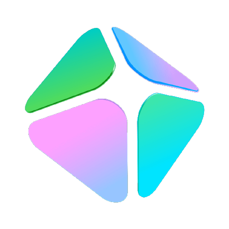
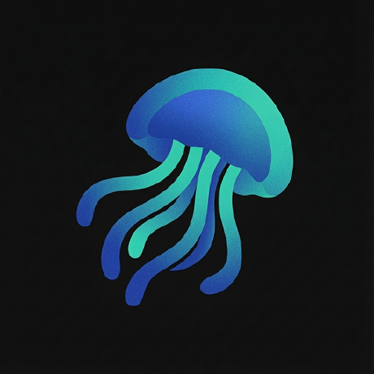
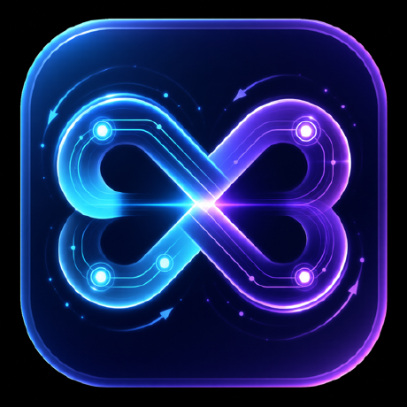
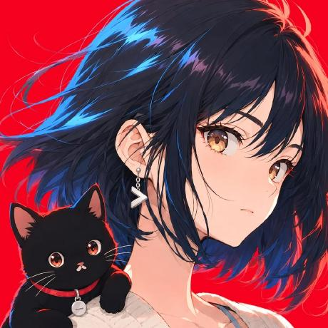
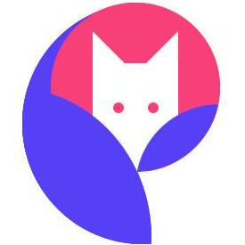
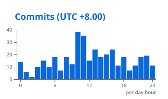
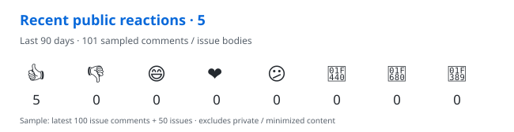

<div align="center">

# Dante / Agent Workbench

<p><samp>TypeScript · AI agents · Open source</samp></p>

<samp>
  <a href="https://dhpie.com">blog</a> ·
  <a href="https://github.com/Dante-dan?tab=repositories">code</a> ·
  <a href="https://github.com/search?q=is%3Apr+author%3ADante-dan&type=pullrequests">contributions</a> ·
  <a href="mailto:duanjl.china@gmail.com">contact</a>
</samp>

</div>

```text
$ whoami
Dante · developer · China

$ cat workflow.txt
question → investigate → build
verify → contribute → write
```

I build with TypeScript and AI agents. I investigate issues, work on fixes,
and contribute to the design discussions behind the tools I use.
I write about the process on [dhpie.com](https://dhpie.com).

[](https://ghfind.com/u/dante-dan?ref=badge)

### `~/workbench`

<sub>Recently pushed public projects · forks excluded</sub>

<!-- workbench:start -->
- **[pi-agent-book](https://github.com/Dante-dan/pi-agent-book)** — 《Pi Agent从入门到精通》：面向零基础的中文开源书，基于源码拆解上下文、记忆、工具、扩展与持续进化，附可复现实验。
- **[web-regression-testing](https://github.com/Dante-dan/web-regression-testing)** — Regression Testing Tools By Puppeteer
- **[dayweave](https://github.com/Dante-dan/dayweave)** — Dayweave · 拾日 — An ambient personal secretary: everyday conversations to lasting text archives and thoughtful insights.
<!-- workbench:end -->

### `~/contributions`

<!-- contributions:start -->
<sub>Code accepted upstream · last 12 months</sub>

<table align="left" width="270"><tr><td width="64" valign="middle"><a href="https://github.com/heygen-com/hyperframes"></a></td><td width="200" valign="middle"><a href="https://github.com/heygen-com/hyperframes"><strong>hyperframes</strong></a><br /><sub><a href="https://github.com/heygen-com/hyperframes/pull/5594">merged contribution</a><br /><a href="https://github.com/heygen-com/hyperframes/pulls?q=is%3Apr+author%3ADante-dan">all PRs ↗</a></sub></td></tr></table>
<table align="left" width="270"><tr><td width="64" valign="middle"><a href="https://github.com/LodyAI/Lody"></a></td><td width="200" valign="middle"><a href="https://github.com/LodyAI/Lody"><strong>Lody</strong></a><br /><sub><a href="https://github.com/LodyAI/Lody/pull/750">merged contribution</a><br /><a href="https://github.com/LodyAI/Lody/pulls?q=is%3Apr+author%3ADante-dan">all PRs ↗</a></sub></td></tr></table>
<table align="left" width="270"><tr><td width="64" valign="middle"><a href="https://github.com/JimLiu/baoyu-skills"></a></td><td width="200" valign="middle"><a href="https://github.com/JimLiu/baoyu-skills"><strong>baoyu-skills</strong></a><br /><sub><a href="https://github.com/JimLiu/baoyu-skills/pull/201">merged contribution</a><br /><a href="https://github.com/JimLiu/baoyu-skills/pulls?q=is%3Apr+author%3ADante-dan">all PRs ↗</a></sub></td></tr></table>
<table align="left" width="270"><tr><td width="64" valign="middle"><a href="https://github.com/CherryHQ/cherry-studio"></a></td><td width="200" valign="middle"><a href="https://github.com/CherryHQ/cherry-studio"><strong>Cherry Studio</strong></a><br /><sub><a href="https://github.com/CherryHQ/cherry-studio/pull/20487">merged contribution</a><br /><a href="https://github.com/CherryHQ/cherry-studio/pulls?q=is%3Apr+author%3ADante-dan">all PRs ↗</a></sub></td></tr></table>
<table align="left" width="270"><tr><td width="64" valign="middle"><a href="https://github.com/affaan-m/ECC"></a></td><td width="200" valign="middle"><a href="https://github.com/affaan-m/ECC"><strong>ECC</strong></a><br /><sub><a href="https://github.com/affaan-m/ECC/pull/3752">merged contribution</a><br /><a href="https://github.com/affaan-m/ECC/pulls?q=is%3Apr+author%3ADante-dan">all PRs ↗</a></sub></td></tr></table>
<table align="left" width="270"><tr><td width="64" valign="middle"><a href="https://github.com/can1357/oh-my-pi"></a></td><td width="200" valign="middle"><a href="https://github.com/can1357/oh-my-pi"><strong>oh-my-pi</strong></a><br /><sub><a href="https://github.com/can1357/oh-my-pi/pull/17061">merged contribution</a><br /><a href="https://github.com/can1357/oh-my-pi/pulls?q=is%3Apr+author%3ADante-dan">all PRs ↗</a></sub></td></tr></table>
<table align="left" width="270"><tr><td width="64" valign="middle"><a href="https://github.com/loopx-project/loopx"></a></td><td width="200" valign="middle"><a href="https://github.com/loopx-project/loopx"><strong>loopx</strong></a><br /><sub><a href="https://github.com/loopx-project/loopx/pull/7349">merged contribution</a><br /><a href="https://github.com/loopx-project/loopx/pulls?q=is%3Apr+author%3ADante-dan">all PRs ↗</a></sub></td></tr></table>
<table align="left" width="270"><tr><td width="64" valign="middle"><a href="https://github.com/cline/cline"></a></td><td width="200" valign="middle"><a href="https://github.com/cline/cline"><strong>cline</strong></a><br /><sub><a href="https://github.com/cline/cline/pull/15296">merged contribution</a><br /><a href="https://github.com/cline/cline/pulls?q=is%3Apr+author%3ADante-dan">all PRs ↗</a></sub></td></tr></table>
<table align="left" width="270"><tr><td width="64" valign="middle"><a href="https://github.com/multica-ai/multica"></a></td><td width="200" valign="middle"><a href="https://github.com/multica-ai/multica"><strong>multica</strong></a><br /><sub><a href="https://github.com/multica-ai/multica/pull/9534">merged contribution</a><br /><a href="https://github.com/multica-ai/multica/pulls?q=is%3Apr+author%3ADante-dan">all PRs ↗</a></sub></td></tr></table>
<table align="left" width="270"><tr><td width="64" valign="middle"><a href="https://github.com/code-yeongyu/oh-my-openagent"></a></td><td width="200" valign="middle"><a href="https://github.com/code-yeongyu/oh-my-openagent"><strong>oh-my-openagent</strong></a><br /><sub><a href="https://github.com/code-yeongyu/oh-my-openagent/pull/11165">merged contribution</a><br /><a href="https://github.com/code-yeongyu/oh-my-openagent/pulls?q=is%3Apr+author%3ADante-dan">all PRs ↗</a></sub></td></tr></table>
<table align="left" width="270"><tr><td width="64" valign="middle"><a href="https://github.com/apache/maka"></a></td><td width="200" valign="middle"><a href="https://github.com/apache/maka"><strong>maka</strong></a><br /><sub><a href="https://github.com/apache/maka/pull/6151">merged contribution</a><br /><a href="https://github.com/apache/maka/pulls?q=is%3Apr+author%3ADante-dan">all PRs ↗</a></sub></td></tr></table>
<table align="left" width="270"><tr><td width="64" valign="middle"><a href="https://github.com/farion1231/cc-switch"></a></td><td width="200" valign="middle"><a href="https://github.com/farion1231/cc-switch"><strong>cc-switch</strong></a><br /><sub><a href="https://github.com/farion1231/cc-switch/pull/8254">merged contribution</a><br /><a href="https://github.com/farion1231/cc-switch/pulls?q=is%3Apr+author%3ADante-dan">all PRs ↗</a></sub></td></tr></table>
<table align="left" width="270"><tr><td width="64" valign="middle"><a href="https://github.com/makecindy/cindy"></a></td><td width="200" valign="middle"><a href="https://github.com/makecindy/cindy"><strong>Cindy</strong></a><br /><sub><a href="https://github.com/makecindy/cindy/pull/4553">merged contribution</a><br /><a href="https://github.com/makecindy/cindy/pulls?q=is%3Apr+author%3ADante-dan">all PRs ↗</a></sub></td></tr></table>
<table align="left" width="270"><tr><td width="64" valign="middle"><a href="https://github.com/anomalyco/opencode"></a></td><td width="200" valign="middle"><a href="https://github.com/anomalyco/opencode"><strong>opencode</strong></a><br /><sub><a href="https://github.com/anomalyco/opencode/pull/55778">merged contribution</a><br /><a href="https://github.com/anomalyco/opencode/pulls?q=is%3Apr+author%3ADante-dan">all PRs ↗</a></sub></td></tr></table>
<table align="left" width="270"><tr><td width="64" valign="middle"><a href="https://github.com/alibaba/open-code-review"></a></td><td width="200" valign="middle"><a href="https://github.com/alibaba/open-code-review"><strong>open-code-review</strong></a><br /><sub><a href="https://github.com/alibaba/open-code-review/pull/1610">merged contribution</a><br /><a href="https://github.com/alibaba/open-code-review/pulls?q=is%3Apr+author%3ADante-dan">all PRs ↗</a></sub></td></tr></table>
<table align="left" width="270"><tr><td width="64" valign="middle"><a href="https://github.com/LodyAI/acp-extension-dsh"></a></td><td width="200" valign="middle"><a href="https://github.com/LodyAI/acp-extension-dsh"><strong>acp-extension-dsh</strong></a><br /><sub><a href="https://github.com/LodyAI/acp-extension-dsh/pull/15">merged contribution</a><br /><a href="https://github.com/LodyAI/acp-extension-dsh/pulls?q=is%3Apr+author%3ADante-dan">all PRs ↗</a></sub></td></tr></table>
<br clear="all" />

<details>
<summary>Earlier contributions</summary>

<table align="left" width="270"><tr><td width="64" valign="middle"><a href="https://github.com/cpsoinos/nuxt-svgo"></a></td><td width="200" valign="middle"><a href="https://github.com/cpsoinos/nuxt-svgo"><strong>nuxt-svgo</strong></a><br /><sub><a href="https://github.com/cpsoinos/nuxt-svgo/pull/201">merged contribution</a><br /><a href="https://github.com/cpsoinos/nuxt-svgo/pulls?q=is%3Apr+author%3ADante-dan">all PRs ↗</a></sub></td></tr></table>
<table align="left" width="270"><tr><td width="64" valign="middle"><a href="https://github.com/GoogleChromeLabs/uach-retrofill"></a></td><td width="200" valign="middle"><a href="https://github.com/GoogleChromeLabs/uach-retrofill"><strong>uach-retrofill</strong></a><br /><sub><a href="https://github.com/GoogleChromeLabs/uach-retrofill/pull/43">merged contribution</a><br /><a href="https://github.com/GoogleChromeLabs/uach-retrofill/pulls?q=is%3Apr+author%3ADante-dan">all PRs ↗</a></sub></td></tr></table>
<table align="left" width="270"><tr><td width="64" valign="middle"><a href="https://github.com/frejs/fre"></a></td><td width="200" valign="middle"><a href="https://github.com/frejs/fre"><strong>fre</strong></a><br /><sub><a href="https://github.com/frejs/fre/pull/264">merged contribution</a><br /><a href="https://github.com/frejs/fre/pulls?q=is%3Apr+author%3ADante-dan">all PRs ↗</a></sub></td></tr></table>
<table align="left" width="270"><tr><td width="64" valign="middle"><a href="https://github.com/youzan/vant"></a></td><td width="200" valign="middle"><a href="https://github.com/youzan/vant"><strong>Vant</strong></a><br /><sub><a href="https://github.com/youzan/vant/pull/8387">merged contribution</a><br /><a href="https://github.com/youzan/vant/pulls?q=is%3Apr+author%3ADante-dan">all PRs ↗</a></sub></td></tr></table>
<br clear="all" />

</details>
<!-- contributions:end -->

### `~/upstream`

<sub>Public upstream PRs updated in the last 7 days · refreshed every 8 hours</sub>

<!-- upstream:start -->
<sub>20 PRs · 20 open</sub>

| Status | Pull request | Updated (UTC) |
| :--- | :--- | :--- |
| `open` | **[CherryHQ/cherry-studio#21422](https://github.com/CherryHQ/cherry-studio/pull/21422)** — fix(chat-errors): preserve provider codes and explain history recovery | 2026-11-27 |
| `open` | **[code-yeongyu/oh-my-openagent#11418](https://github.com/code-yeongyu/oh-my-openagent/pull/11418)** — fix(senpi): report unstaged LSP runtime and stage preload builds | 2026-11-27 |
| `open` | **[CherryHQ/cherry-studio#21355](https://github.com/CherryHQ/cherry-studio/pull/21355)** — feat(web-search): choose search and fetch providers per assistant | 2026-11-27 |
| `open` | **[CherryHQ/cherry-studio#20434](https://github.com/CherryHQ/cherry-studio/pull/20434)** — fix(ai): stabilize OpenRouter session routing | 2026-11-27 |
| `open` | **[alibaba/open-code-review#1797](https://github.com/alibaba/open-code-review/pull/1797)** — feat(telemetry): expose per-attempt LLM HTTP spans | 2026-11-27 |
| `open` | **[farion1231/cc-switch#8800](https://github.com/farion1231/cc-switch/pull/8800)** — fix(codex): preserve image tool discovery through local routing | 2026-11-27 |
| `open` | **[CherryHQ/cherry-studio#20486](https://github.com/CherryHQ/cherry-studio/pull/20486)** — fix(knowledge): handle oversized Zhipu reranks | 2026-11-27 |
| `open` | **[farion1231/cc-switch#8156](https://github.com/farion1231/cc-switch/pull/8156)** — fix(codex): reject unsupported encrypted agent tasks in chat conversion | 2026-11-27 |
| `open` | **[farion1231/cc-switch#8647](https://github.com/farion1231/cc-switch/pull/8647)** — feat(provider): refresh Claude Desktop providers from Claude Code | 2026-11-27 |
| `open` | **[code-yeongyu/oh-my-openagent#10138](https://github.com/code-yeongyu/oh-my-openagent/pull/10138)** — docs(install): explain npm package-name bin conflicts | 2026-11-27 |
| `open` | **[farion1231/cc-switch#8568](https://github.com/farion1231/cc-switch/pull/8568)** — fix(provider): remind users to check active provider after adding | 2026-11-27 |
| `open` | **[farion1231/cc-switch#8232](https://github.com/farion1231/cc-switch/pull/8232)** — feat(codex): persist restart notice dismissal preference | 2026-11-27 |
| `open` | **[CherryHQ/cherry-studio#20353](https://github.com/CherryHQ/cherry-studio/pull/20353)** — fix(ai-runtime): clamp agent output token limit | 2026-11-27 |
| `open` | **[cloudflare/security-audit-skill#82](https://github.com/cloudflare/security-audit-skill/pull/82)** — fix: allow artifact sharing within an archived attempt | 2026-11-24 |
| `open` | **[apache/maka#6226](https://github.com/apache/maka/pull/6226)** — fix(runtime-host): add explicit managed root identity recovery | 2026-11-24 |
| `open` | **[apache/maka#6262](https://github.com/apache/maka/pull/6262)** — fix(runtime): handle recovered unknown calls in compaction | 2026-11-23 |
| `open` | **[apache/maka#6198](https://github.com/apache/maka/pull/6198)** — feat(desktop): unify Personal Assistant task panel densities | 2026-11-21 |
| `open` | **[apache/maka#6212](https://github.com/apache/maka/pull/6212)** — fix(desktop): keep lightbox close clear of window controls | 2026-11-21 |
| `open` | **[farion1231/cc-switch#8642](https://github.com/farion1231/cc-switch/pull/8642)** — fix(usage): use Chinese units for compact token counts | 2026-11-20 |
| `open` | **[farion1231/cc-switch#8893](https://github.com/farion1231/cc-switch/pull/8893)** — feat(apps): add compact and large-card display density | 2026-11-20 |
<!-- upstream:end -->

<details>
<summary>Recent conversations · issues, comments &amp; reviews</summary>

<!-- activity:start -->
- `2026-11-19` Commented on **[cloudflare/security-audit-skill#82](https://github.com/cloudflare/security-audit-skill/pull/82#issuecomment-7006512426)** — fix: allow artifact sharing within an archived attempt
- `2026-11-04` Commented on **[makecindy/cindy#7191](https://github.com/makecindy/cindy/pull/7191#issuecomment-6627614994)** — fix(desktop): distinguish upstream resource quota from Cindy balance
<!-- activity:end -->

</details>

[More contributions →](https://github.com/search?q=is%3Apr+author%3ADante-dan&type=pullrequests)

### `~/notes`

<sub>Latest writing from [dhpie.com](https://dhpie.com)</sub>

<!-- notes:start -->
- [把 Session 还给系统：拆解 DeepSeek Harness 的 Super-agent](https://dhpie.com/posts/cn/deepseek-harness-super-agent-teardown)
- [开源贡献日报 · 2026-10-26](https://dhpie.com/posts/cn/open-source-daily-2026-10-26)
- [开源贡献日报 · 2026-10-19](https://dhpie.com/posts/cn/open-source-daily-2026-10-19)
- [开源贡献日报 · 2026-10-21](https://dhpie.com/posts/cn/open-source-daily-2026-10-21)
<!-- notes:end -->

### `~/telemetry`

<picture>
  <source media="(prefers-color-scheme: dark)" srcset="https://raw.githubusercontent.com/Dante-dan/Dante-dan/main/assets/telemetry/stats-dark-2e0a48196f8e100e.svg" />
  
</picture>
<picture>
  <source media="(prefers-color-scheme: dark)" srcset="https://raw.githubusercontent.com/Dante-dan/Dante-dan/main/assets/telemetry/time-dark-d8c0468578e25a45.svg" />
  
</picture>




<!-- telemetry-refresh:start -->
<sub>Fetched every 8 hours · last successful fetch<br>Totals: 2026-11-27 04:22:24 UTC · Commit hours: 2026-11-27 04:22:24 UTC · Reactions: 2026-11-27 04:22:24 UTC</sub>
<!-- telemetry-refresh:end -->

### `~/arcade`

<picture>
  <source media="(prefers-color-scheme: dark)" srcset="https://raw.githubusercontent.com/Dante-dan/Dante-dan/output/bomberman-contribution-graph-dark.svg" />
  
</picture>

<sub>Bomberman · powered by <a href="https://github.com/abozanona/pacman-contribution-graph">Arcade Contribution Graph</a></sub>

---

<sub>Refreshed every 8 hours with GitHub Actions · [Workflow](.github/workflows/profile.yml) · [Blog](https://dhpie.com)</sub>
