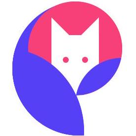

<div align="center">

# Dante / Agent Workbench

<p><samp>TypeScript · AI agents · Open source</samp></p>

<samp>
  <a href="https://dhpie.com">blog</a> ·
  <a href="https://github.com/Dante-dan?tab=repositories">code</a> ·
  <a href="https://github.com/search?q=is%3Apr+author%3ADante-dan&type=pullrequests">contributions</a> ·
  <a href="mailto:duanjl.china@gmail.com">contact</a>
</samp>

</div>

```text
$ whoami
Dante · developer · China

$ cat workflow.txt
question → investigate → build
verify → contribute → write
```

I build with TypeScript and AI agents. I investigate issues, work on fixes,
and contribute to the design discussions behind the tools I use.
I write about the process on [dhpie.com](https://dhpie.com).

[](https://ghfind.com/u/dante-dan?ref=badge)

### `~/workbench`

<sub>Recently pushed public projects · forks excluded</sub>

<!-- workbench:start -->
- **[pi-agent-learning-lab](https://github.com/Dante-dan/pi-agent-learning-lab)** — Interactive Chinese learning lab for Pi Agent extensions, SDK, tools, sessions, providers, and production patterns
- **[pi-agent-book](https://github.com/Dante-dan/pi-agent-book)** — 《Pi Agent从入门到精通》：面向零基础的中文开源书，基于源码拆解上下文、记忆、工具、扩展与持续进化，附可复现实验。
- **[dan-skills](https://github.com/Dante-dan/dan-skills)** — Public TypeScript project.
<!-- workbench:end -->

### `~/contributions`

<!-- contributions:start -->
<sub>Code accepted upstream · last 12 months</sub>

<table align="left" width="270"><tr><td width="64" valign="middle"><a href="https://github.com/makecindy/cindy"></a></td><td width="200" valign="middle"><a href="https://github.com/makecindy/cindy"><strong>Cindy</strong></a><br /><sub><a href="https://github.com/makecindy/cindy/pull/5296">merged contribution</a><br /><a href="https://github.com/makecindy/cindy/pulls?q=is%3Apr+author%3ADante-dan">all PRs ↗</a></sub></td></tr></table>
<table align="left" width="270"><tr><td width="64" valign="middle"><a href="https://github.com/CherryHQ/cherry-studio"></a></td><td width="200" valign="middle"><a href="https://github.com/CherryHQ/cherry-studio"><strong>Cherry Studio</strong></a><br /><sub><a href="https://github.com/CherryHQ/cherry-studio/pull/21558">merged contribution</a><br /><a href="https://github.com/CherryHQ/cherry-studio/pulls?q=is%3Apr+author%3ADante-dan">all PRs ↗</a></sub></td></tr></table>
<table align="left" width="270"><tr><td width="64" valign="middle"><a href="https://github.com/cline/cline"></a></td><td width="200" valign="middle"><a href="https://github.com/cline/cline"><strong>cline</strong></a><br /><sub><a href="https://github.com/cline/cline/pull/14400">merged contribution</a><br /><a href="https://github.com/cline/cline/pulls?q=is%3Apr+author%3ADante-dan">all PRs ↗</a></sub></td></tr></table>
<table align="left" width="270"><tr><td width="64" valign="middle"><a href="https://github.com/code-yeongyu/oh-my-openagent"></a></td><td width="200" valign="middle"><a href="https://github.com/code-yeongyu/oh-my-openagent"><strong>oh-my-openagent</strong></a><br /><sub><a href="https://github.com/code-yeongyu/oh-my-openagent/pull/9469">merged contribution</a><br /><a href="https://github.com/code-yeongyu/oh-my-openagent/pulls?q=is%3Apr+author%3ADante-dan">all PRs ↗</a></sub></td></tr></table>
<table align="left" width="270"><tr><td width="64" valign="middle"><a href="https://github.com/apache/maka"></a></td><td width="200" valign="middle"><a href="https://github.com/apache/maka"><strong>maka</strong></a><br /><sub><a href="https://github.com/apache/maka/pull/5202">merged contribution</a><br /><a href="https://github.com/apache/maka/pulls?q=is%3Apr+author%3ADante-dan">all PRs ↗</a></sub></td></tr></table>
<table align="left" width="270"><tr><td width="64" valign="middle"><a href="https://github.com/affaan-m/ECC"></a></td><td width="200" valign="middle"><a href="https://github.com/affaan-m/ECC"><strong>ECC</strong></a><br /><sub><a href="https://github.com/affaan-m/ECC/pull/3491">merged contribution</a><br /><a href="https://github.com/affaan-m/ECC/pulls?q=is%3Apr+author%3ADante-dan">all PRs ↗</a></sub></td></tr></table>
<table align="left" width="270"><tr><td width="64" valign="middle"><a href="https://github.com/can1357/oh-my-pi"></a></td><td width="200" valign="middle"><a href="https://github.com/can1357/oh-my-pi"><strong>oh-my-pi</strong></a><br /><sub><a href="https://github.com/can1357/oh-my-pi/pull/14558">merged contribution</a><br /><a href="https://github.com/can1357/oh-my-pi/pulls?q=is%3Apr+author%3ADante-dan">all PRs ↗</a></sub></td></tr></table>
<table align="left" width="270"><tr><td width="64" valign="middle"><a href="https://github.com/alibaba/open-code-review"></a></td><td width="200" valign="middle"><a href="https://github.com/alibaba/open-code-review"><strong>open-code-review</strong></a><br /><sub><a href="https://github.com/alibaba/open-code-review/pull/1610">merged contribution</a><br /><a href="https://github.com/alibaba/open-code-review/pulls?q=is%3Apr+author%3ADante-dan">all PRs ↗</a></sub></td></tr></table>
<table align="left" width="270"><tr><td width="64" valign="middle"><a href="https://github.com/heygen-com/hyperframes"></a></td><td width="200" valign="middle"><a href="https://github.com/heygen-com/hyperframes"><strong>hyperframes</strong></a><br /><sub><a href="https://github.com/heygen-com/hyperframes/pull/4809">merged contribution</a><br /><a href="https://github.com/heygen-com/hyperframes/pulls?q=is%3Apr+author%3ADante-dan">all PRs ↗</a></sub></td></tr></table>
<table align="left" width="270"><tr><td width="64" valign="middle"><a href="https://github.com/LodyAI/acp-extension-dsh"></a></td><td width="200" valign="middle"><a href="https://github.com/LodyAI/acp-extension-dsh"><strong>acp-extension-dsh</strong></a><br /><sub><a href="https://github.com/LodyAI/acp-extension-dsh/pull/15">merged contribution</a><br /><a href="https://github.com/LodyAI/acp-extension-dsh/pulls?q=is%3Apr+author%3ADante-dan">all PRs ↗</a></sub></td></tr></table>
<table align="left" width="270"><tr><td width="64" valign="middle"><a href="https://github.com/LodyAI/Lody"></a></td><td width="200" valign="middle"><a href="https://github.com/LodyAI/Lody"><strong>Lody</strong></a><br /><sub><a href="https://github.com/LodyAI/Lody/pull/587">merged contribution</a><br /><a href="https://github.com/LodyAI/Lody/pulls?q=is%3Apr+author%3ADante-dan">all PRs ↗</a></sub></td></tr></table>
<table align="left" width="270"><tr><td width="64" valign="middle"><a href="https://github.com/multica-ai/multica"></a></td><td width="200" valign="middle"><a href="https://github.com/multica-ai/multica"><strong>multica</strong></a><br /><sub><a href="https://github.com/multica-ai/multica/pull/8297">merged contribution</a><br /><a href="https://github.com/multica-ai/multica/pulls?q=is%3Apr+author%3ADante-dan">all PRs ↗</a></sub></td></tr></table>
<br clear="all" />

<details>
<summary>Earlier contributions</summary>

<table align="left" width="270"><tr><td width="64" valign="middle"><a href="https://github.com/cpsoinos/nuxt-svgo"></a></td><td width="200" valign="middle"><a href="https://github.com/cpsoinos/nuxt-svgo"><strong>nuxt-svgo</strong></a><br /><sub><a href="https://github.com/cpsoinos/nuxt-svgo/pull/201">merged contribution</a><br /><a href="https://github.com/cpsoinos/nuxt-svgo/pulls?q=is%3Apr+author%3ADante-dan">all PRs ↗</a></sub></td></tr></table>
<table align="left" width="270"><tr><td width="64" valign="middle"><a href="https://github.com/GoogleChromeLabs/uach-retrofill"></a></td><td width="200" valign="middle"><a href="https://github.com/GoogleChromeLabs/uach-retrofill"><strong>uach-retrofill</strong></a><br /><sub><a href="https://github.com/GoogleChromeLabs/uach-retrofill/pull/43">merged contribution</a><br /><a href="https://github.com/GoogleChromeLabs/uach-retrofill/pulls?q=is%3Apr+author%3ADante-dan">all PRs ↗</a></sub></td></tr></table>
<table align="left" width="270"><tr><td width="64" valign="middle"><a href="https://github.com/frejs/fre"></a></td><td width="200" valign="middle"><a href="https://github.com/frejs/fre"><strong>fre</strong></a><br /><sub><a href="https://github.com/frejs/fre/pull/264">merged contribution</a><br /><a href="https://github.com/frejs/fre/pulls?q=is%3Apr+author%3ADante-dan">all PRs ↗</a></sub></td></tr></table>
<table align="left" width="270"><tr><td width="64" valign="middle"><a href="https://github.com/youzan/vant"></a></td><td width="200" valign="middle"><a href="https://github.com/youzan/vant"><strong>Vant</strong></a><br /><sub><a href="https://github.com/youzan/vant/pull/8387">merged contribution</a><br /><a href="https://github.com/youzan/vant/pulls?q=is%3Apr+author%3ADante-dan">all PRs ↗</a></sub></td></tr></table>
<br clear="all" />

</details>
<!-- contributions:end -->

### `~/upstream`

<sub>Public upstream PRs updated in the last 7 days · refreshed every 8 hours</sub>

<!-- upstream:start -->
<sub>89 PRs · 75 open · 14 merged</sub>

| Status | Pull request | Updated (UTC) |
| :--- | :--- | :--- |
| `open` | **[farion1231/cc-switch#8254](https://github.com/farion1231/cc-switch/pull/8254)** — fix(hermes): read live WSL databases inside their distribution | 2026-10-13 |
| `open` | **[code-yeongyu/oh-my-openagent#9625](https://github.com/code-yeongyu/oh-my-openagent/pull/9625)** — refactor(senpi): load memory prompt compiler on demand | 2026-10-13 |
| `open` | **[nuxt/modules#1059](https://github.com/nuxt/modules/pull/1059)** — feat: add \`nuxt-inline-scripts\` | 2026-10-13 |
| `open` | **[CherryHQ/cherry-studio#21312](https://github.com/CherryHQ/cherry-studio/pull/21312)** — fix(model-settings): explain saved modality overrides | 2026-10-13 |
| `open` | **[CherryHQ/cherry-studio#20353](https://github.com/CherryHQ/cherry-studio/pull/20353)** — fix(ai-runtime): clamp agent output token limit | 2026-10-13 |
| `open` | **[apache/maka#6085](https://github.com/apache/maka/pull/6085)** — fix(cli): preserve fullscreen editor and status on short terminals | 2026-10-13 |
| `open` | **[anomalyco/opencode#55039](https://github.com/anomalyco/opencode/pull/55039)** — fix(server): report capped file search indexes | 2026-10-13 |
| `open` | **[farion1231/cc-switch#8232](https://github.com/farion1231/cc-switch/pull/8232)** — feat(codex): persist restart notice dismissal preference | 2026-10-13 |
| `merged` | **[makecindy/cindy#5296](https://github.com/makecindy/cindy/pull/5296)** — fix(runtime): preserve Codex transport in automatic fallback | 2026-10-13 |
| `merged` | **[CherryHQ/cherry-studio#21558](https://github.com/CherryHQ/cherry-studio/pull/21558)** — feat(heartbeat): configure per-agent execution timeout | 2026-10-13 |
| `open` | **[apache/maka#5218](https://github.com/apache/maka/pull/5218)** — fix(desktop): add HTML artifact Finder fallback | 2026-10-13 |
| `open` | **[CherryHQ/cherry-studio#21223](https://github.com/CherryHQ/cherry-studio/pull/21223)** — feat(xai-tools): add opt-in native Grok images in chat | 2026-10-13 |
| `open` | **[CherryHQ/cherry-studio#21133](https://github.com/CherryHQ/cherry-studio/pull/21133)** — feat(agent-knowledge): add per-binding read/write permissions | 2026-10-13 |
| `open` | **[heygen-com/hyperframes#5430](https://github.com/heygen-com/hyperframes/pull/5430)** — fix(engine): await seek completion during drawElement batches | 2026-10-13 |
| `merged` | **[heygen-com/hyperframes#5469](https://github.com/heygen-com/hyperframes/pull/5469)** — fix(media): read ElevenLabs input as UTF-8 | 2026-10-12 |
| `open` | **[anomalyco/opencode#54942](https://github.com/anomalyco/opencode/pull/54942)** — fix(core): refresh MCP tools before session snapshots | 2026-10-12 |
| `open` | **[anomalyco/opencode#54939](https://github.com/anomalyco/opencode/pull/54939)** — fix(app): preserve KaTeX MathML annotations | 2026-10-12 |
| `open` | **[anomalyco/opencode#54937](https://github.com/anomalyco/opencode/pull/54937)** — fix(core): migrate legacy message ID prefixes | 2026-10-12 |
| `open` | **[makecindy/cindy#4424](https://github.com/makecindy/cindy/pull/4424)** — feat(mobile): render Mermaid in Markdown file reader | 2026-10-12 |
| `open` | **[anomalyco/opencode#54883](https://github.com/anomalyco/opencode/pull/54883)** — fix(client): preserve initializing service contenders | 2026-10-12 |
| `open` | **[CherryHQ/cherry-studio#21317](https://github.com/CherryHQ/cherry-studio/pull/21317)** — fix(agent-stream): reject billed empty assistant completions | 2026-10-12 |
| `open` | **[anomalyco/opencode#54878](https://github.com/anomalyco/opencode/pull/54878)** — fix(core): skip missing locations during reload | 2026-10-12 |
| `open` | **[anomalyco/opencode#54877](https://github.com/anomalyco/opencode/pull/54877)** — fix(desktop): sign zip data descriptors | 2026-10-12 |
| `open` | **[can1357/oh-my-pi#13436](https://github.com/can1357/oh-my-pi/pull/13436)** — feat(tui): copy or rewind from either transcript selector | 2026-10-12 |
| `open` | **[CherryHQ/cherry-studio#21422](https://github.com/CherryHQ/cherry-studio/pull/21422)** — fix(chat-errors): preserve provider codes and explain history recovery | 2026-10-12 |
| `merged` | **[cline/cline#14400](https://github.com/cline/cline/pull/14400)** — fix(sdk): require string old\_text in editor schema | 2026-10-12 |
| `open` | **[makecindy/cindy#4551](https://github.com/makecindy/cindy/pull/4551)** — fix(desktop): acknowledge opened background tasks | 2026-10-12 |
| `open` | **[makecindy/cindy#4553](https://github.com/makecindy/cindy/pull/4553)** — fix(desktop): clear event-backed attention after task deletion | 2026-10-12 |
| `open` | **[makecindy/cindy#4366](https://github.com/makecindy/cindy/pull/4366)** — fix(mobile): avoid stale device roster snapshot | 2026-10-12 |
| `open` | **[anomalyco/opencode#54709](https://github.com/anomalyco/opencode/pull/54709)** — fix(core): preserve provider credential availability | 2026-10-12 |
| `open` | **[apache/maka#5266](https://github.com/apache/maka/pull/5266)** — fix(runtime): allow bounded Apple Git startup | 2026-10-12 |
| `open` | **[makecindy/cindy#5295](https://github.com/makecindy/cindy/pull/5295)** — fix(mobile): constrain iOS sheet scrolling to native viewport | 2026-10-12 |
| `open` | **[alibaba/open-code-review#1637](https://github.com/alibaba/open-code-review/pull/1637)** — feat(action): split review and publication for fresh App tokens | 2026-10-12 |
| `open` | **[code-yeongyu/oh-my-openagent#9619](https://github.com/code-yeongyu/oh-my-openagent/pull/9619)** — fix(senpi): enable reviewer artifact lookup through eval | 2026-10-12 |
| `open` | **[alibaba/open-code-review#1629](https://github.com/alibaba/open-code-review/pull/1629)** — feat(scan): support bounded scan prompt template overrides | 2026-10-12 |
| `open` | **[alibaba/open-code-review#1664](https://github.com/alibaba/open-code-review/pull/1664)** — fix(review): pin ordinary commit-backed input before loading | 2026-10-12 |
| `open` | **[alibaba/open-code-review#1644](https://github.com/alibaba/open-code-review/pull/1644)** — fix(config): clear optional custom provider fields | 2026-10-12 |
| `open` | **[farion1231/cc-switch#8156](https://github.com/farion1231/cc-switch/pull/8156)** — fix(codex): reject unsupported encrypted agent tasks in chat conversion | 2026-10-12 |
| `merged` | **[code-yeongyu/oh-my-openagent#9469](https://github.com/code-yeongyu/oh-my-openagent/pull/9469)** — test: detect environment leaks at test-file teardown | 2026-10-12 |
| `open` | **[anomalyco/opencode#53874](https://github.com/anomalyco/opencode/pull/53874)** — fix(core): preserve global canonical on session moves | 2026-10-11 |
| `open` | **[cloudflare/security-audit-skill#74](https://github.com/cloudflare/security-audit-skill/pull/74)** — feat: model shared validation blockers in findings | 2026-10-11 |
| `merged` | **[apache/maka#5202](https://github.com/apache/maka/pull/5202)** — fix(desktop): update Windows taskbar app icon | 2026-10-11 |
| `merged` | **[affaan-m/ECC#3491](https://github.com/affaan-m/ECC/pull/3491)** — fix(hooks): price Claude 5.5 per deduplicated request | 2026-10-11 |
| `merged` | **[can1357/oh-my-pi#14558](https://github.com/can1357/oh-my-pi/pull/14558)** — fix(coding-agent): show resolved diagnostic and SSH config paths | 2026-10-10 |
| `open` | **[code-yeongyu/oh-my-openagent#9437](https://github.com/code-yeongyu/oh-my-openagent/pull/9437)** — test(team-mode): make fallback cancellation gate deterministic | 2026-10-10 |
| `open` | **[anomalyco/opencode#53266](https://github.com/anomalyco/opencode/pull/53266)** — fix(core): disable tool selection in compaction summaries | 2026-10-10 |
| `open` | **[anomalyco/opencode#53122](https://github.com/anomalyco/opencode/pull/53122)** — refactor(core): extract transcript projection | 2026-10-10 |
| `open` | **[anomalyco/opencode#52635](https://github.com/anomalyco/opencode/pull/52635)** — fix(core): release detached location graphs after reload | 2026-10-10 |
| `open` | **[anomalyco/opencode#52187](https://github.com/anomalyco/opencode/pull/52187)** — fix(tui): release oversized session message caches on switch | 2026-10-10 |
| `open` | **[anomalyco/opencode#52145](https://github.com/anomalyco/opencode/pull/52145)** — fix(core): show structured provider error details | 2026-10-10 |
| `open` | **[anomalyco/opencode#52148](https://github.com/anomalyco/opencode/pull/52148)** — docs: list Context7 OpenCode plugin | 2026-10-10 |
| `open` | **[anomalyco/opencode#52094](https://github.com/anomalyco/opencode/pull/52094)** — fix(app): keep new sessions in their selected worktree | 2026-10-10 |
| `open` | **[anomalyco/opencode#51805](https://github.com/anomalyco/opencode/pull/51805)** — fix(app): keep nested directory for local sessions | 2026-10-10 |
| `open` | **[anomalyco/opencode#51528](https://github.com/anomalyco/opencode/pull/51528)** — fix(app): keep workspace message text readable on accent themes | 2026-10-10 |
| `open` | **[anomalyco/opencode#49943](https://github.com/anomalyco/opencode/pull/49943)** — fix(tui): widen tab close target | 2026-10-10 |
| `open` | **[anomalyco/opencode#49808](https://github.com/anomalyco/opencode/pull/49808)** — fix(core): register compatible Responses provider | 2026-10-10 |
| `open` | **[code-yeongyu/oh-my-openagent#9684](https://github.com/code-yeongyu/oh-my-openagent/pull/9684)** — feat(work-with-pr): batch PR watch fingerprints before detail reads | 2026-10-10 |
| `open` | **[code-yeongyu/oh-my-openagent#9693](https://github.com/code-yeongyu/oh-my-openagent/pull/9693)** — feat(pr-watch): persist host polling and session wake receipts | 2026-10-10 |
| `merged` | **[apache/maka#5900](https://github.com/apache/maka/pull/5900)** — fix(runtime): bound proxied fetch transport teardown | 2026-10-10 |
| `open` | **[code-yeongyu/oh-my-openagent#9603](https://github.com/code-yeongyu/oh-my-openagent/pull/9603)** — perf(senpi): lazy-load mutation formatting outside startup | 2026-10-10 |
| `open` | **[code-yeongyu/oh-my-openagent#9621](https://github.com/code-yeongyu/oh-my-openagent/pull/9621)** — fix(task): settle idle host child admission errors | 2026-10-10 |
| `open` | **[code-yeongyu/oh-my-openagent#9604](https://github.com/code-yeongyu/oh-my-openagent/pull/9604)** — fix(lsp): retain writer error handling through teardown | 2026-10-10 |
| `open` | **[code-yeongyu/oh-my-openagent#9613](https://github.com/code-yeongyu/oh-my-openagent/pull/9613)** — test(senpi-task): make acknowledged fallback close deterministic | 2026-10-10 |
| `open` | **[CherryHQ/cherry-studio#21360](https://github.com/CherryHQ/cherry-studio/pull/21360)** — docs(tool-approval): clarify scheduled session delegation | 2026-10-10 |
| `open` | **[CherryHQ/cherry-studio#21355](https://github.com/CherryHQ/cherry-studio/pull/21355)** — feat(web-search): choose search and fetch providers per assistant | 2026-10-10 |
| `merged` | **[affaan-m/ECC#3119](https://github.com/affaan-m/ECC/pull/3119)** — fix(install): keep target-compatible modules with cross-harness dependencies | 2026-10-10 |
| `merged` | **[cline/cline#14670](https://github.com/cline/cline/pull/14670)** — fix(desktop): explain missing Git during skill install | 2026-10-09 |
| `open` | **[browser-use/jev-ultrafast#200](https://github.com/browser-use/jev-ultrafast/pull/200)** — fix: identify selected fields in text helper context | 2026-10-09 |
| `open` | **[heygen-com/hyperframes#5183](https://github.com/heygen-com/hyperframes/pull/5183)** — fix(engine): include untimed overlays in HDR stacking | 2026-10-08 |
| `merged` | **[code-yeongyu/oh-my-openagent#9602](https://github.com/code-yeongyu/oh-my-openagent/pull/9602)** — fix(senpi): keep task executors out of ultrawork orchestration | 2026-10-08 |
| `open` | **[can1357/oh-my-pi#12082](https://github.com/can1357/oh-my-pi/pull/12082)** — feat(coding-agent): add producer-scoped artifact resolution | 2026-10-07 |
| `open` | **[can1357/oh-my-pi#12083](https://github.com/can1357/oh-my-pi/pull/12083)** — fix(coding-agent): clarify omp identity in system prompt | 2026-10-07 |
| `open` | **[can1357/oh-my-pi#12081](https://github.com/can1357/oh-my-pi/pull/12081)** — feat(github): support operation-specific approval policies | 2026-10-07 |
| `open` | **[can1357/oh-my-pi#12253](https://github.com/can1357/oh-my-pi/pull/12253)** — fix(session): anchor exit marker to persisted tail | 2026-10-07 |
| `open` | **[can1357/oh-my-pi#12381](https://github.com/can1357/oh-my-pi/pull/12381)** — test(browser): require a live CDP endpoint for Linux Chromium | 2026-10-07 |
| `open` | **[can1357/oh-my-pi#12394](https://github.com/can1357/oh-my-pi/pull/12394)** — fix(coding-agent): save manual handoff artifacts when enabled | 2026-10-07 |
| `open` | **[can1357/oh-my-pi#12378](https://github.com/can1357/oh-my-pi/pull/12378)** — fix(session): relocate custom sessions across filesystems | 2026-10-07 |
| `open` | **[can1357/oh-my-pi#12818](https://github.com/can1357/oh-my-pi/pull/12818)** — fix(natives): keep macOS TUI sessions out of the Dock | 2026-10-07 |
| `open` | **[can1357/oh-my-pi#13437](https://github.com/can1357/oh-my-pi/pull/13437)** — feat(coding-agent): honor skill model for invoked task turns | 2026-10-07 |
| `open` | **[can1357/oh-my-pi#13976](https://github.com/can1357/oh-my-pi/pull/13976)** — feat(tui): support multi-row top chrome for extension composers | 2026-10-07 |
| `open` | **[can1357/oh-my-pi#13771](https://github.com/can1357/oh-my-pi/pull/13771)** — fix(glob): return empty result for a missing single path | 2026-10-07 |
| `open` | **[can1357/oh-my-pi#14133](https://github.com/can1357/oh-my-pi/pull/14133)** — fix(coding-agent): reject unknown slash commands locally | 2026-10-07 |
| `open` | **[can1357/oh-my-pi#14440](https://github.com/can1357/oh-my-pi/pull/14440)** — fix(ai): preserve GLM-5.2 thinking on Ollama Cloud | 2026-10-07 |
| `open` | **[can1357/oh-my-pi#14439](https://github.com/can1357/oh-my-pi/pull/14439)** — Coalesce identical advisor notes within a review batch | 2026-10-07 |
| `open` | **[can1357/oh-my-pi#14542](https://github.com/can1357/oh-my-pi/pull/14542)** — feat(coding-agent): log skipped extension directory errors | 2026-10-07 |
| `open` | **[can1357/oh-my-pi#14580](https://github.com/can1357/oh-my-pi/pull/14580)** — feat(extensions): expose configured thinking selector | 2026-10-07 |
| `merged` | **[CherryHQ/cherry-studio#21334](https://github.com/CherryHQ/cherry-studio/pull/21334)** — feat(web-search): add self-hosted Crawl4AI URL fetching | 2026-10-07 |
| `open` | **[makecindy/cindy#5180](https://github.com/makecindy/cindy/pull/5180)** — feat(desktop): request consent for non-Git project recovery | 2026-10-06 |
| `merged` | **[can1357/oh-my-pi#13956](https://github.com/can1357/oh-my-pi/pull/13956)** — docs(coding-agent): show complete read range calls | 2026-10-06 |
<!-- upstream:end -->

<details>
<summary>Recent conversations · issues, comments &amp; reviews</summary>

<!-- activity:start -->
- `2026-10-13` Commented on **[farion1231/cc-switch#8205](https://github.com/farion1231/cc-switch/issues/8205#issuecomment-6138620634)** — \[Bug\] Windows 版 CC Switch 无法通过 WSL UNC 路径实时读取 Hermes SQLite 会话数据库
- `2026-10-13` Commented on **[apache/maka#6082](https://github.com/apache/maka/issues/6082#issuecomment-6138205310)** — bug(tui): fullscreen multiline drafts clip status on short terminals
- `2026-10-13` Commented on **[anomalyco/opencode#54940](https://github.com/anomalyco/opencode/issues/54940#issuecomment-6138311418)** — v2: non-Git file search drops existing files after refreshing its capped index
- `2026-10-13` Commented on **[anomalyco/opencode#54985](https://github.com/anomalyco/opencode/issues/54985#issuecomment-6138507345)** — web: DOCX preview renders Chinese characters as squares
<!-- activity:end -->

</details>

[More contributions →](https://github.com/search?q=is%3Apr+author%3ADante-dan&type=pullrequests)

### `~/notes`

<sub>Latest writing from [dhpie.com](https://dhpie.com)</sub>

<!-- notes:start -->
- [开源贡献日报 · 2026-10-12](https://dhpie.com/posts/cn/open-source-daily-2026-10-12)
- [开源贡献日报 · 2026-10-11](https://dhpie.com/posts/cn/open-source-daily-2026-10-11)
- [开源贡献日报 · 2026-10-10](https://dhpie.com/posts/cn/open-source-daily-2026-10-10)
- [开源贡献日报 · 2026-10-08](https://dhpie.com/posts/cn/open-source-daily-2026-10-08)
<!-- notes:end -->

### `~/telemetry`

<picture>
  <source media="(prefers-color-scheme: dark)" srcset="https://raw.githubusercontent.com/Dante-dan/Dante-dan/main/assets/telemetry/stats-dark-a1f7d55297b036e0.svg" />
  
</picture>
<picture>
  <source media="(prefers-color-scheme: dark)" srcset="https://raw.githubusercontent.com/Dante-dan/Dante-dan/main/assets/telemetry/time-dark-f382f7cb119a55ac.svg" />
  
</picture>


<!-- telemetry-refresh:start -->
<sub>Fetched every 8 hours · last successful fetch<br>Totals: 2026-10-13 14:26:48 UTC · Commit hours: 2026-10-13 14:26:48 UTC · Reactions: 2026-10-13 14:26:48 UTC</sub>
<!-- telemetry-refresh:end -->

### `~/arcade`

<picture>
  <source media="(prefers-color-scheme: dark)" srcset="https://raw.githubusercontent.com/Dante-dan/Dante-dan/output/bomberman-contribution-graph-dark.svg" />
  
</picture>

<sub>Bomberman · powered by <a href="https://github.com/abozanona/pacman-contribution-graph">Arcade Contribution Graph</a></sub>

---

<sub>Refreshed every 8 hours with GitHub Actions · [Workflow](.github/workflows/profile.yml) · [Blog](https://dhpie.com)</sub>
